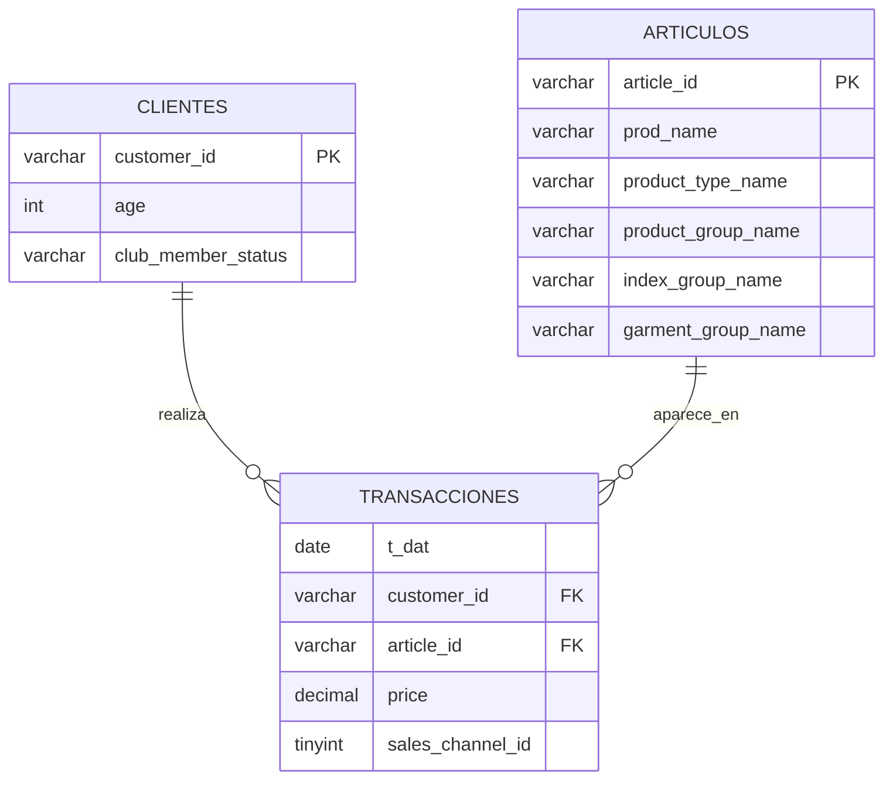
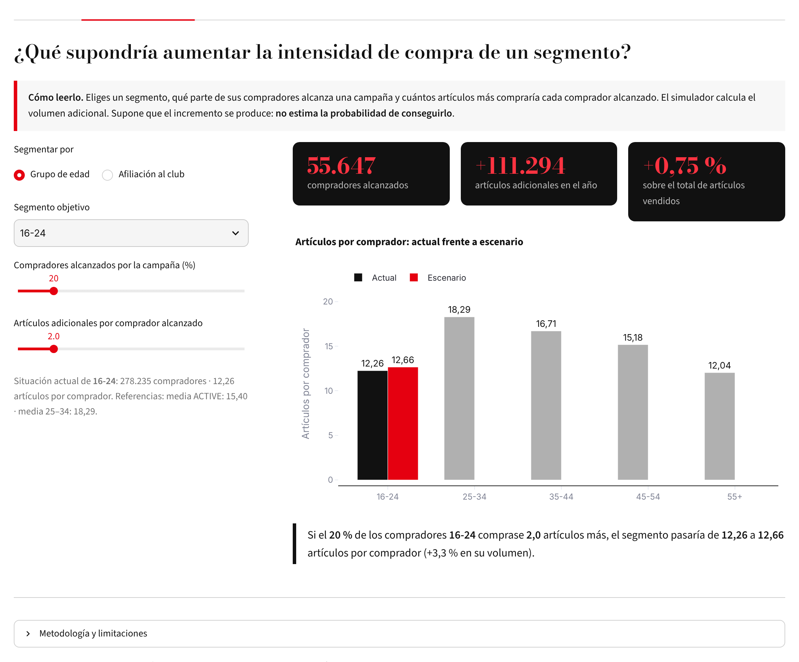

# Muchos datos, poca visión

### H&M Retail Intelligence · ¿Cómo convertir millones de transacciones en decisiones sobre clientes, productos y canales?


> **Proyecto final · Data Analytics Bootcamp (Ironhack) · Caso práctico 2: análisis de datos de principio a fin**
> Diagnóstico comercial de **14,9 millones de artículos vendidos** por H&M entre septiembre de 2019 y septiembre de 2020, con Python, MySQL y Tableau.

🎤 **Presentación:** [Diapositivas del proyecto](https://claude.ai/artifact/XoVnxjusRMbLNh5mR4H4Jq)
🗣️ **Guion (8 min):** [GUION_PRESENTACION.md](GUION_PRESENTACION.md)
📊 **Dashboard:** [`tableau/HM_Retail_Intelligence.twbx`](tableau/HM_Retail_Intelligence.twbx)
🧪 **Simulador (Streamlit):** [`app/app.py`](app/app.py) · *[URL de Streamlit Cloud]*

---

## Índice

1. [Pregunta de negocio](#1-pregunta-de-negocio)
2. [Destinatarios](#2-destinatarios)
3. [Datos](#3-datos)
4. [Metodología](#4-metodología)
5. [Limpieza y preparación](#5-limpieza-y-preparación)
6. [Base de datos](#6-base-de-datos)
7. [Análisis SQL](#7-análisis-sql)
8. [Dashboard de Tableau](#8-dashboard-de-tableau)
9. [Principales hallazgos](#9-principales-hallazgos)
10. [Recomendaciones](#10-recomendaciones)
11. [Simulador de escenarios (Streamlit)](#11-simulador-de-escenarios-streamlit)
12. [Limitaciones y próximos pasos](#12-limitaciones-y-próximos-pasos)
13. [Estructura del repositorio](#13-estructura-del-repositorio)
14. [Cómo reproducir el proyecto](#14-cómo-reproducir-el-proyecto)

---

## 1. Pregunta de negocio

> **¿Cómo puede H&M utilizar sus datos de transacciones para entender mejor su actividad comercial y detectar oportunidades de mejora en clientes, productos y canales de venta?**

H&M opera con un catálogo amplio, perfiles de cliente muy distintos y varios canales de venta. Cada transacción genera información, pero millones de registros no equivalen a una visión clara del negocio.

El problema no es que H&M venda mal (eso no lo sabemos). El problema analítico es que **los datos transaccionales, por sí solos, no ofrecen una visión integrada y fácil de interpretar para orientar decisiones comerciales**.

Este proyecto es un **diagnóstico comercial basado en datos históricos**. No predice ventas futuras ni evalúa la rentabilidad.

El análisis se organiza en cuatro bloques:

| Bloque | Pregunta |
|---|---|
| **Sales Performance** | ¿Cómo evoluciona la actividad comercial mes a mes? |
| **Customer Intelligence** | ¿Qué segmentos de clientes concentran la actividad y con qué intensidad compran? |
| **Product Intelligence** | ¿Qué categorías y líneas comerciales tienen más peso en las ventas? |
| **Sales Channel Intelligence** | ¿Qué diferencias hay entre canales en volumen, surtido y perfil de cliente? |

## 2. Destinatarios

El proyecto se plantea desde el rol de **Data Analyst del equipo de estrategia comercial**:

- **Dirección comercial y estrategia:** dónde se concentra la actividad y qué oportunidades priorizar.
- **CRM y marketing:** diferencias entre segmentos para diseñar y evaluar acciones comerciales.
- **Producto y planificación comercial:** distribución de artículos vendidos por categoría, canal y periodo.

Los dashboards están pensados para equipos internos que toman decisiones comerciales, no para el cliente final de H&M.

## 3. Datos

**Fuente:** [H&M Personalized Fashion Recommendations](https://www.kaggle.com/competitions/h-and-m-personalized-fashion-recommendations/data) (Kaggle), un dataset público con datos reales anonimizados.

| Archivo | Registros | Columnas | Contenido |
|---|---:|---:|---|
| `transactions_train.csv` | 31.788.324 | 5 | Fecha, cliente, artículo, precio normalizado y canal (20/09/2018 – 22/09/2020) |
| `customers.csv` | 1.371.980 | 7 | Edad, estado en el club, newsletter, código postal anonimizado |
| `articles.csv` | 105.542 | 25 | Nombre, tipo de producto, categoría, línea comercial, grupo de prenda, color… |

> **Clave de lectura.** Cada fila de transacciones es **un artículo vendido, no un pedido** (el dataset no tiene identificador de pedido). Los precios están **normalizados** y no representan euros.

*Los CSV originales (≈3,5 GB) no se incluyen en el repositorio por su tamaño. Hay que descargarlos de Kaggle en `data/raw/`.*

## 4. Metodología

```
 CSV en bruto  ──►  Python (pandas)  ──►  MySQL  ──►  Tableau  ──►  Decisiones
                    EDA, limpieza,        Modelo       5 dashboards   3 recomendaciones
                    filtrado por bloques  relacional   + KPIs         + KPIs de seguimiento
                                          + 19 consultas
```

1. **Python:** exploración, evaluación de calidad, limpieza, transformación y exportación de los datasets preparados.
2. **MySQL:** modelo relacional, importación con `LOAD DATA LOCAL INFILE`, validación de integridad y consultas de negocio.
3. **Tableau:** visualizaciones interactivas, campos calculados, expresiones LOD y conclusiones.

### Selección del periodo

El dataset completo (31,8 M de filas) no era viable en MySQL Workbench en local. Se eligió un **ciclo anual completo, del 23/09/2019 al 22/09/2020**:

- **14.898.423 transacciones** (46,87 % del original, una reducción del 53,13 %).
- **994.320 compradores únicos.**
- Se conserva **todo el historial** de cada cliente dentro del periodo, en lugar de muestrear filas, para no distorsionar el análisis de recurrencia.

## 5. Limpieza y preparación

Todo el proceso está documentado en [`notebooks/Proyecto_HM.ipynb`](notebooks/Proyecto_HM.ipynb). Debido al volumen, las transacciones se procesan **por bloques (`chunksize`)**, sin cargar el archivo completo en memoria. Las funciones reutilizables se guardan en `Funciones.py`.

| Hallazgo | Decisión | Resultado |
|---|---|---|
| `age` con 1,16 % de nulos (15.861) | Se conservan como `NULL`; en SQL se agrupan como *Edad desconocida*. No se imputan edades artificiales | 0 registros eliminados |
| `club_member_status` con 0,44 % de nulos | Se sustituyen por la categoría `UNKNOWN` | 0 registros eliminados |
| `FN` y `Active` con ≈65 % de nulos; código postal anonimizado | Se excluyen, junto con `fashion_news_frequency`, por no ser necesarias para las preguntas de negocio | 7 → 3 columnas |
| `age` como `float64` sin decimales reales | Conversión a `Int64` (entero que admite nulos) | Tipo coherente |
| Catálogo con 25 atributos | Se conservan 6: `article_id`, `prod_name`, `product_type_name`, `product_group_name`, `index_group_name`, `garment_group_name` | 25 → 6 columnas |
| `prod_name` repetido en 22.955 nombres | Se usa `article_id` como identificador único | Rankings sin agrupaciones erróneas |
| `article_id` con ceros iniciales | Se lee y exporta como texto | Correspondencia exacta entre tablas |
| Transacciones fuera del periodo | Filtrado por bloques de 100.000 filas | 14.898.423 registros, 0 fuera de rango |
| Integridad referencial | Comprobación en Python de que todos los `customer_id` y `article_id` existen | 100 % de coincidencia, 0 huérfanos |

Después de cada exportación se vuelve a leer el CSV para validar el número de registros, los tipos, los nulos y los duplicados.

## 6. Base de datos

Modelo relacional en MySQL (`hm_retail_intelligence`), diseñado en MySQL Workbench ([`modelo/HM_Retail_Intelligence_Model.mwb`](modelo/HM_Retail_Intelligence_Model.mwb)).



| Tabla | Filas |
|---|---:|
| `clientes` | 1.371.980 |
| `articulos` | 105.542 |
| `transacciones` | 14.898.423 |

### Incidencias resueltas

- **Importación de artículos:** el primer intento cargó solo 4 filas, con una advertencia de truncamiento (1265). En Python se descartó que fuera por la longitud de los `VARCHAR` y se detectaron saltos de línea `\r\n`. Al ajustar `LINES TERMINATED BY '\r\n'` se cargaron las 105.542 filas.
- **Rendimiento:** los `JOIN` sobre 14,9 M de filas eran inviables sin índices. Se creó `idx_transacciones_cliente` sobre `customer_id`, y se resolvió un bloqueo de metadatos causado por una consulta anterior que seguía activa.
- **Optimización de consultas:** pre-agregación de transacciones por artículo y canal antes del `JOIN`, una tabla temporal de clientes por tramo de edad y `STRAIGHT_JOIN` para fijar el orden de acceso. Una consulta de edad × categoría llegó a tardar 588 s antes de optimizarla.

## 7. Análisis SQL

Los scripts están en [`sql/`](sql/). Cada consulta incluye su objetivo, el resultado obtenido, la conclusión de negocio y sus limitaciones.

| Script | Bloque | Consultas |
|---|---|---|
| [`04_analisis_ventas.sql`](sql/04_analisis_ventas.sql) | Sales Performance | SQL 01–05: periodo y volumen, compradores únicos, evolución mensual, meses de máxima y mínima actividad, precio normalizado |
| [`05_analisis_clientes.sql`](sql/05_analisis_clientes.sql) | Customer Intelligence | SQL 06–09: compradores, artículos e intensidad de compra por edad y por estado del club |
| [`06_analisis_productos.sql`](sql/06_analisis_productos.sql) | Product Intelligence | SQL 10–14: top 10 artículos, categorías, líneas comerciales, preferencias por edad, catálogo frente a ventas |
| [`07_analisis_canales.sql`](sql/07_analisis_canales.sql) | Sales Channel Intelligence | SQL 15–19: peso de cada canal, evolución mensual, categorías y edad por canal |
| [`08_analisis_segmentacion.sql`](sql/08_analisis_segmentacion.sql) | Segmentación y mix | Media y mediana por afiliación, categorías por afiliación, evolución mensual de categorías |

**Técnicas utilizadas:** `INNER JOIN`, `GROUP BY`, funciones de agregación (`COUNT`, `COUNT(DISTINCT)`, `SUM`, `AVG`, `MIN`, `MAX`), `CASE WHEN` para los tramos de edad, CTE (`WITH`), funciones de ventana (`ROW_NUMBER() OVER`, `COUNT(*) OVER`) para calcular la **mediana**, que MySQL no tiene como función nativa, subconsultas, tablas temporales, índices y `STRAIGHT_JOIN`.

## 8. Dashboard de Tableau

Libro: [`tableau/HM_Retail_Intelligence.twbx`](tableau/HM_Retail_Intelligence.twbx). Tiene 17 hojas y 5 dashboards, construidos sobre los resultados agregados de las consultas SQL.

Los dashboards cuentan **una sola historia**. Cada uno responde una pregunta y lleva a la siguiente:

| Orden | Dashboard | Pregunta | Visualizaciones clave |
|:---:|---|---|---|
| 1 | **Visión general del negocio** | ¿Qué está ocurriendo en el negocio? | KPIs de artículos y compradores; evolución mensual de ambas métricas |
| 2 | **Oportunidades de clientes** | ¿Quién está detrás de la actividad? | Artículos por edad; media y mediana por afiliación; mix de categorías por afiliación |
| 3 | **Productos y canales de venta** | ¿Qué compran y por qué canal? | Top 10 categorías con filtro de canal; mapa de calor categoría × canal; canales por edad |
| 4 | **Evolución del mix de productos** *(Dashboard 5 en Tableau)* | ¿Cambia la composición con el tiempo? | % mensual de Upper body, Lower body y Swimwear |
| 5 | **Decisiones estratégicas** *(Dashboard 4 en Tableau)* | ¿Qué decisiones proponemos? | Evidencia → acción → objetivo, y KPIs de seguimiento |

**Elementos técnicos:** campos calculados (porcentaje sobre el total, agrupación de categorías destacadas), expresiones **LOD `{ FIXED }`** para calcular el peso de cada categoría dentro de cada canal y de cada mes, y notas metodológicas en cada dashboard.

## 9. Principales hallazgos

### 9.1 Visión general
- **14.898.423 artículos vendidos** y **994.320 compradores únicos** en 12 meses.
- **Pico en junio de 2020:** 1.764.507 artículos y 305.018 compradores, máximo en ambas métricas.
- **Mínimo de un mes completo en febrero de 2020:** 1.001.859 artículos. Entre el valle y el pico hay un +76 %.
- Cada comprador adquiere de media **14,98 artículos**, con una **mediana de 8**. La distribución está sesgada: el 10 % compra un único artículo y el máximo llega a 1.020.
- En **abril de 2020 no hay registros del canal 1**. Puede estar relacionado con circunstancias externas, pero el dataset no permite confirmarlo.

### 9.2 Clientes
| Grupo de edad | Compradores | Artículos | Artículos / comprador |
|---|---:|---:|---:|
| 16–24 | 278.235 | 3.411.052 | 12,26 |
| **25–34** | **292.768** | **5.355.293** | **18,29** |
| 35–44 | 109.225 | 1.825.345 | 16,71 |
| 45–54 | 179.941 | 2.730.622 | 15,18 |
| 55+ | 126.175 | 1.518.947 | 12,04 |
| Edad desconocida | 7.976 | 57.164 | 7,17 |

- **25–34 lidera en volumen (35,9 % de los artículos) y en intensidad (18,29 artículos por comprador).**
- 16–24 es el segundo grupo por número de compradores, pero de los últimos en intensidad. Es un margen de crecimiento por cliente.

| Afiliación | Compradores | Media | Mediana |
|---|---:|---:|---:|
| ACTIVE | 951.428 | 15,40 | 8 |
| PRE-CREATE | 39.875 | 5,48 | 3 |
| UNKNOWN | 2.755 | 9,63 | 4 |
| LEFT CLUB | 262 | 9,03 | 5 |

- ACTIVE representa el 95,69 % de los compradores y el **98,34 % de los artículos**.
- **Media y mediana responden a preguntas distintas.** En los dos grupos la media supera a la mediana porque hay pocos clientes muy activos, pero la diferencia entre ACTIVE y PRE-CREATE se mantiene con ambas métricas.
- El mix también cambia: PRE-CREATE tiene más peso en Swimwear (9,51 % frente a 7,66 %) y Underwear (10,56 % frente a 8,74 %), y ACTIVE en Accessories (5,11 % frente a 3,22 %).
- ⚠️ Es una **asociación, no causalidad**: pertenecer al club no demuestra que se compre más.

### 9.3 Productos y canales
- **Garment Upper body: 38,62 %** de los artículos (5,75 M). Con Lower body (21,83 %) suman el **60,45 %**.
- **Ladieswear concentra el 65,79 %** de los artículos y, con Divided, el 87,93 %.
- Artículo más vendido: *Jade HW Skinny Denim TRS* (0706016001), con 30.209 unidades.
- **Tener más referencias no implica vender más:** Swimwear vende 1,14 M artículos con 3.127 referencias, y Accessories 757 K con 11.158.
- **El canal 2 concentra el 71,85 %** de los artículos (10,70 M frente a 4,19 M).
- **Volumen y participación no son lo mismo:** Upper body pesa un **42,93 % en el canal 1** y un **36,94 % en el canal 2**. Accessories y Socks & Tights venden más unidades en el canal 1.
- Por edad, el grupo 25–34 compra el 76,26 % por el canal 2, frente al 68,27 % del grupo 45–54.
- Los canales **no se identifican como tienda física u online**, porque los datos no permiten asegurar esa correspondencia.

### 9.4 Evolución del mix
- **Garment Upper body** baja de ≈50 % del total mensual (sep. 2019) al **30 % (mayo y junio de 2020)** y después recupera peso. Es un cambio de peso relativo, no necesariamente de volumen absoluto.
- **Swimwear** pasa de ≈1 % a un **15,6 % en mayo de 2020**.
- **Garment Lower body** se mantiene estable, entre el 19 % y el 24 %.
- Con un solo año de datos, **no se puede confirmar una estacionalidad recurrente**.

## 10. Recomendaciones

| # | Decisión | Evidencia | Acción | KPI de seguimiento |
|:-:|---|---|---|---|
| 1 | **Planificar el surtido según la demanda** | Upper y Lower body suman el 60,45 %; el peso de las categorías cambia cada mes | Revisar la disponibilidad y composición del surtido por categoría, canal y periodo | Volumen y peso mensual de cada categoría por canal |
| 2 | **Probar campañas segmentadas** | 25–34 tiene 18,29 artículos por comprador; ACTIVE 15,40 / 8 frente a PRE-CREATE 5,48 / 3 | Diseñar y probar campañas por edad y afiliación, empezando por los segmentos con menos intensidad de compra | Media y mediana de artículos por comprador, antes y después |
| 3 | **Diferenciar la estrategia por canal** | El canal 2 tiene el 71,85 %; el mix de categorías y el perfil de edad cambian entre canales | Probar surtido y comunicación diferenciados por canal | Cuota de cada canal y peso de cada categoría dentro del canal |

> Son recomendaciones **basadas en patrones observados**. No son resultados de experimentos ni garantizan una mejora. El siguiente paso es validarlas con pruebas controladas (A/B).

## 11. Simulador de escenarios (Streamlit)

Para llevar las recomendaciones a la práctica he creado una app interactiva en Streamlit ([`app/app.py`](app/app.py)). Funciona con los mismos **resultados agregados de las consultas SQL** que alimentan Tableau, así que no necesita MySQL ni los datos en bruto.



| Pestaña | Pregunta | Qué se puede mover |
|---|---|---|
| **Visión general** | ¿Coinciden los picos de artículos y de compradores? | — |
| **① Campañas segmentadas** | ¿Qué supondría aumentar la intensidad de compra de un segmento? | Segmento (edad o afiliación), % de compradores alcanzados y artículos adicionales por comprador |
| **② Surtido y temporada** | ¿Qué categorías ganan o pierden peso cada mes? | Grupo de edad, mes y categorías del gráfico |
| **③ Estrategia por canal** | ¿Cómo cambia el mix total si cambia el peso de cada canal? | Cuota del canal 2 |
| **④ Previsión de demanda** | ¿Cuánta demanda cabe esperar en los próximos 12 meses y cómo se reparte por categoría? | Crecimiento frente al año anterior, meses de campaña e impacto esperado, mes a planificar |

> Los resultados son **escenarios hipotéticos calculados sobre patrones observados**, no predicciones. La app lo indica en cada pestaña.

**Previsión de demanda.** Se usa la serie mensual completa del EDA (sep 2018 – sep 2020). El modelo es *estacional ajustado*: cada mes se calcula como el mismo mes del año anterior multiplicado por el crecimiento reciente (últimos 3 meses frente a los mismos meses del año previo). Se validó con un **backtest** sobre oct 2019 – ago 2020, prediciendo cada mes solo con la información anterior:

| Modelo | MAPE |
|---|---:|
| **Estacional ajustado** | **10,5 %** |
| Último mes (naive) | 10,9 % |
| Media móvil 3 meses | 13,9 % |
| Mismo mes del año anterior | 14,0 % |

Se eligió el modelo más sencillo con menor error. La previsión se muestra con una banda de ±10,5 % y es **orientativa**: solo hay dos años de datos y 2020 está afectado por la pandemia.

**Ejecutar en local**

```bash
cd app
pip install -r requirements.txt
streamlit run app.py
```

**Publicar gratis** en [Streamlit Community Cloud](https://share.streamlit.io): *New app* → elegir este repositorio → *Main file path*: `HM_Retail_Intelligence/app/app.py` → *Deploy*.

## 12. Limitaciones y próximos pasos

**Limitaciones**
- No hay identificador de pedido, así que se miden artículos y no tickets ni visitas.
- Los precios están normalizados, por lo que no se pueden calcular ingresos ni rentabilidad reales.
- El significado de los canales 1 y 2 no está documentado.
- Solo se analiza un año: no permite confirmar patrones estacionales.
- Septiembre de 2019 y septiembre de 2020 son meses parciales.
- El análisis es descriptivo: muestra asociaciones, no relaciones causales.

**Próximos pasos**
- Ampliar el análisis a los dos años disponibles para comparar temporadas.
- Segmentación **RFM** y análisis de **cohortes** de retención.
- Validar las recomendaciones con pruebas A/B.
- Automatizar la carga de datos y publicar el dashboard en Tableau Public.
- Ampliar el simulador con datos de varios años para estimar rangos de variación.

## 13. Estructura del repositorio

```
HM_Retail_Intelligence/
├── README.md                       # Documentación del proyecto
├── GUION_PRESENTACION.md           # Guion de la presentación (8 min)
├── notebooks/
│   └── Proyecto_HM.ipynb           # EDA, limpieza, preparación y validación
├── sql/
│   ├── 04_analisis_ventas.sql      # Sales Performance
│   ├── 05_analisis_clientes.sql    # Customer Intelligence
│   ├── 06_analisis_productos.sql   # Product Intelligence
│   ├── 07_analisis_canales.sql     # Sales Channel Intelligence
│   └── 08_analisis_segmentacion.sql# Afiliación y evolución del mix
├── app/
│   ├── app.py                      # Simulador de escenarios (Streamlit)
│   ├── requirements.txt
│   ├── captura_simulador.png
│   ├── .streamlit/config.toml      # Tema rojo, negro y blanco
│   └── data/                       # Resultados agregados de las consultas SQL (CSV)
├── modelo/
│   └── HM_Retail_Intelligence_Model.mwb  # Modelo EER (MySQL Workbench)
└── tableau/
    └── HM_Retail_Intelligence.twbx # 17 hojas · 5 dashboards
```

## 14. Cómo reproducir el proyecto

1. **Descargar los datos** de [Kaggle](https://www.kaggle.com/competitions/h-and-m-personalized-fashion-recommendations/data) (`customers.csv`, `articles.csv`, `transactions_train.csv`) en `data/raw/`.
2. **Instalar las dependencias:** `pip install pandas matplotlib jupyter`.
3. **Ejecutar** `notebooks/Proyecto_HM.ipynb`, que genera en `data/processed/`:
   `clientes_preparados.csv`, `articulos_preparados.csv` y `transacciones_preparadas.csv`.
4. **Crear la base de datos** `hm_retail_intelligence` a partir del modelo `.mwb` (*Database → Forward Engineer* en MySQL Workbench).
5. **Importar los CSV** con `LOAD DATA LOCAL INFILE` (con `LINES TERMINATED BY '\r\n'`) y crear el índice sobre `transacciones.customer_id`.
6. **Ejecutar los scripts** `sql/04` a `sql/08` en orden.
7. **Abrir** `tableau/HM_Retail_Intelligence.twbx` con Tableau Desktop o Tableau Public, que ya incluye los datos agregados.
8. **Lanzar el simulador:** `cd app && streamlit run app.py`.

---

**Autora:** Beatriz Fernández · Data Analytics Bootcamp, Ironhack
